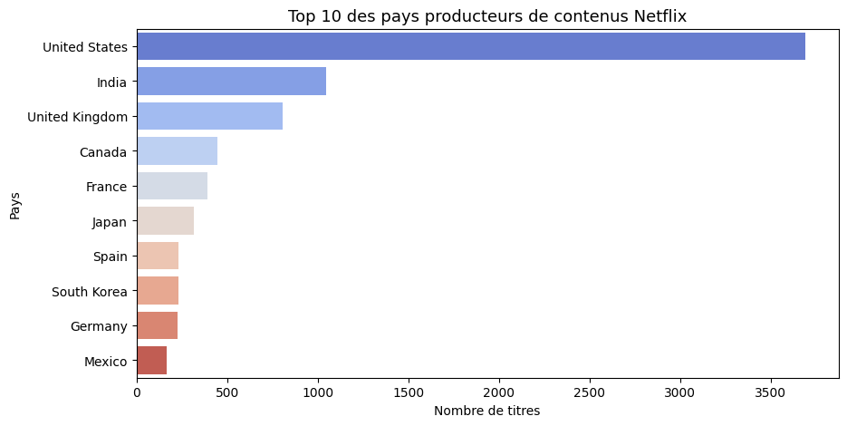
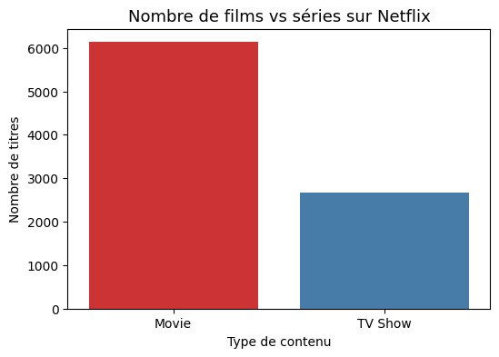
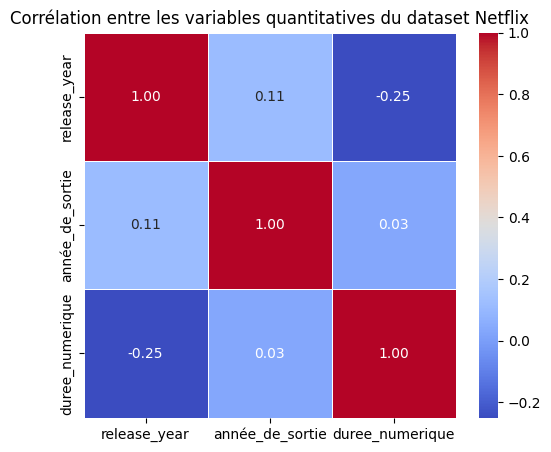

# Netflix Data Visualization

Analyse exploratoire du catalogue Netflix à partir du jeu de données public
`shivamb/netflix-shows` disponible sur Kaggle. Le notebook télécharge les
données, prépare les variables utiles et produit plusieurs visualisations avec
Pandas, Seaborn et Matplotlib.



## Démarche

1. Téléchargement du dataset avec KaggleHub.
2. Sélection des colonnes utiles et traitement des valeurs manquantes.
3. Analyse des types de contenu, des années, des genres et des pays.
4. Étude des durées et des corrélations entre variables quantitatives.
5. Restitution des résultats dans un rapport de 11 pages.

## Résultats principaux

- Le dataset contient **8 807 titres** : 6 131 films et 2 676 séries.
- Les États-Unis arrivent en tête avec 3 690 occurrences, devant l'Inde
  (1 046) et le Royaume-Uni (806).
- L'année de sortie la plus représentée est 2018 avec 1 147 titres.
- Les corrélations calculées entre année de sortie, année d'ajout et durée
  restent faibles dans ce jeu de données.

| Répartition des contenus | Matrice de corrélation |
|---|---|
|  |  |

## Contenu du dépôt

- [`netflix-analysis.ipynb`](netflix-analysis.ipynb) : préparation, analyses et graphiques.
- [`docs/netflix-analysis-report.pdf`](docs/netflix-analysis-report.pdf) : rapport de synthèse.
- `docs/` : graphiques extraits du notebook.

## Exécution

```bash
python -m venv .venv
.venv\Scripts\activate
pip install -r requirements.txt
jupyter notebook netflix-analysis.ipynb
```

Le notebook télécharge le dataset public au premier lancement et génère
localement `netflix_clean.csv`.

## Limites

Les chiffres décrivent le dataset utilisé et non l'intégralité du catalogue
Netflix actuel. Les contenus associés à plusieurs pays ou genres sont éclatés
pour les comptages, ce qui explique que les totaux par catégorie puissent
dépasser le nombre de titres.

